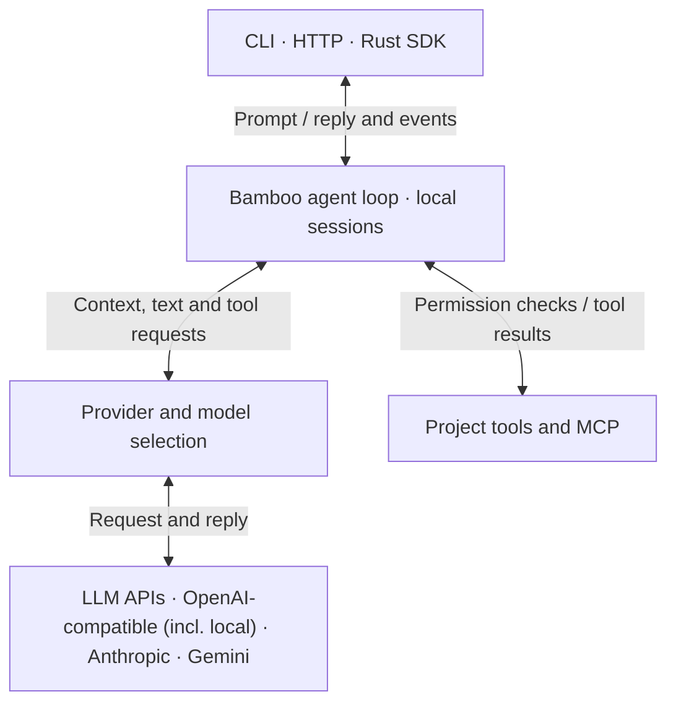
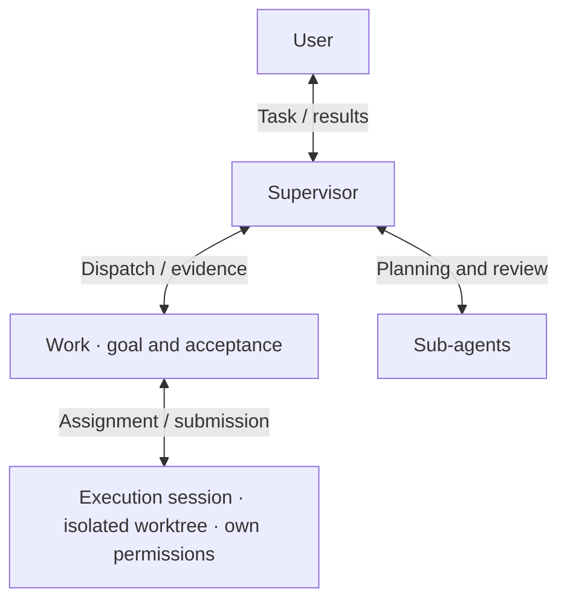
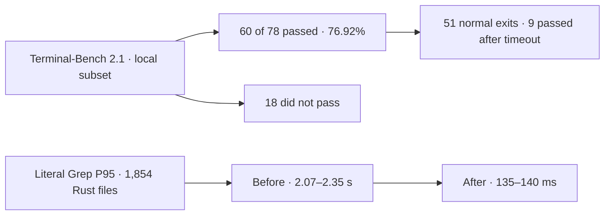
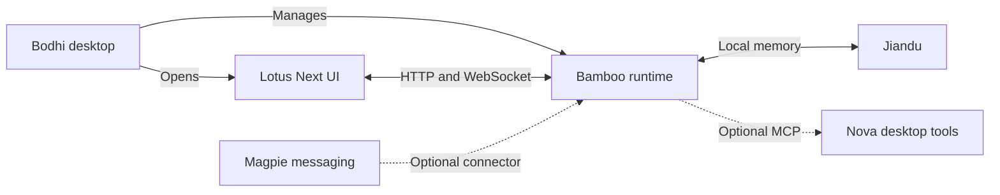

# Bamboo 🎋

Our goal is to build the most advanced open-source agent harness with a fast Rust runtime. Run it from your terminal, serve it over HTTP, or embed it with the SDK. Choose the models and tools you need, and keep your sessions on your machine.

When a task spans several sessions, keeping up with each one takes time. Give [Supervisor](#supervisor) the goal. It assigns work, tracks progress, and gathers results. You can see what each session did and handle approvals and acceptance when needed.

[Quickstart](#try-it) · [Integration](#build-with-bamboo) · [Benchmarks](#benchmarks) · [Architecture](#architecture) · [Contribute](#contribute) · [简体中文](./README.zh-CN.md)

## Try it

### Install

Download the executable for your platform from the [latest GitHub release](https://github.com/bigduu/Bamboo-agent/releases/latest).

| Platform | Prebuilt executable |
|---|---|
| macOS | [Apple Silicon](https://github.com/bigduu/Bamboo-agent/releases/latest/download/bamboo-aarch64-apple-darwin) |
| Linux | [x64](https://github.com/bigduu/Bamboo-agent/releases/latest/download/bamboo-x86_64-unknown-linux-gnu) · [ARM64](https://github.com/bigduu/Bamboo-agent/releases/latest/download/bamboo-aarch64-unknown-linux-gnu) |
| Windows | [x64](https://github.com/bigduu/Bamboo-agent/releases/latest/download/bamboo-x86_64-pc-windows-msvc.exe) · [ARM64](https://github.com/bigduu/Bamboo-agent/releases/latest/download/bamboo-aarch64-pc-windows-msvc.exe) |

Rename the executable to `bamboo` (`bamboo.exe` on Windows) and put it on your `PATH`. On macOS and Linux, make it executable with `chmod +x bamboo`.

If you already use Rust, install the published crate with Cargo.

```bash
cargo install bamboo-agent --locked
```

### Run your first task

On first use, choose a provider and enter its API key in the setup wizard. To specify a model available to your account, run `bamboo init --model YOUR_MODEL_ID`.

```bash
bamboo init
```

Change to the directory of a project whose `README.md` documents its test command and ask Bamboo to find it.

```bash
cd "/path/to/sample-project"
bamboo -p "Read the file at $PWD/README.md and tell me the exact command to run this project's tests. Do not edit any files."
```

```text
Read README.md
Run the tests using the following command: `python3 -m unittest discover -s tests`
```

Excerpt from a Bamboo CLI run.

For browser chat, run `bamboo serve` with the frontend and open [localhost:9562](http://127.0.0.1:9562). [CLI guide](./docs/guides/GETTING_STARTED.md#a-headless-one-shot-fastest-way-to-see-it-work) · [Custom model setup](./docs/config-reference.md#choosing-a-provider-and-model)

## Build with Bamboo



[HTTP example](./docs/guides/GETTING_STARTED.md#b-http-server--curl) · [API reference](./docs/guides/API.md) · [Rust SDK example](./examples/sdk_quickstart.rs) · [Model setup](./docs/config-reference.md#choosing-a-provider-and-model)

## Supervisor



[Supervisor](./docs/supervisor-identity.md#model-role-and-thinking-mode) · [Work controls](./docs/guides/TICKET_CONTROLS.md) · [Sub-agent settings](./docs/config-reference.md#sub-agents--external-cli-executors)

## Bodhi desktop app

Bodhi prepares and runs Bamboo for you from a desktop window. The terminal installer supports Apple Silicon Macs running macOS 13.5 or later and Linux x64 distributions that use APT.

```sh
curl -q --proto '=https' --proto-redir '=https' --tlsv1.2 -fsSL https://bigduu.github.io/Pavilion/install.sh | sh
```

[Bodhi downloads](https://github.com/bigduu/Bodhi-AI/releases/latest)

## Benchmarks



[Terminal-Bench results and method](./docs/benchmarks/terminal-bench-2.1-2026-11-15/README.md) · [Grep measurements](https://github.com/bigduu/Bamboo-agent/pull/3014)

## Architecture



[Architecture guide](./docs/architecture.md)

## Docs

[Build from source](./docs/guides/GETTING_STARTED.md#build-from-source) · [Configuration](./docs/config-reference.md) · [Deployment](./docs/guides/DEPLOY.md)

## Contribute

We’d like to hear how you use Bamboo and where you get stuck. Report a bug, propose a design change, or contribute code, docs, examples, or benchmark results.

[GitHub Issues](https://github.com/bigduu/Bamboo-agent/issues) · [Contribution guide](./CONTRIBUTING.md)

## License

[MIT](./LICENSE) · [Third-party notices](./THIRD_PARTY_NOTICES.md) · [Skill Creator (Apache-2.0)](./builtin_skills/skill-creator/LICENSE.txt)
