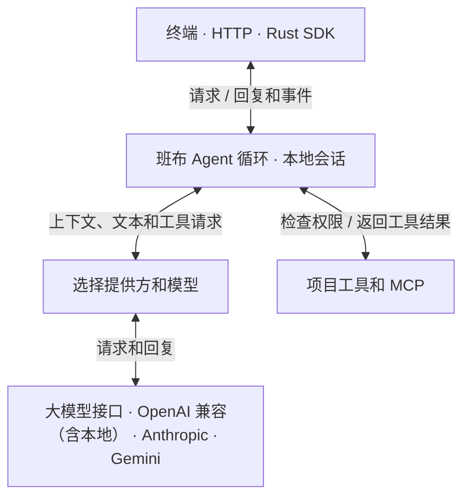
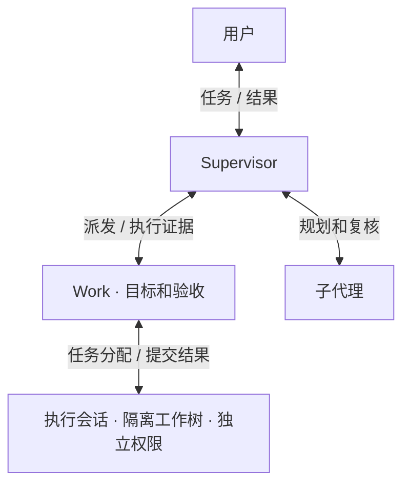
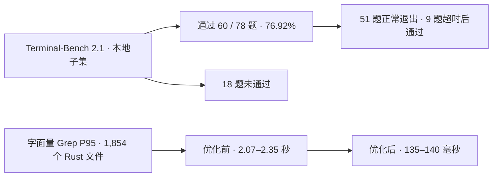
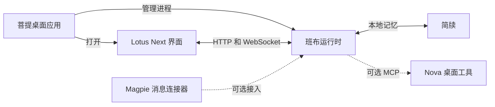

# Bamboo 班布 🎋

我们想把班布做成最先进的开源 Agent Harness，用 Rust 把运行开销做低。同一套引擎可以在终端跑，通过 HTTP 调用，也能用 SDK 嵌进自己的应用。模型和工具按需要配置，会话保存在本地。

一个任务拆到多个会话后，来回切换、追进度、收结果都费时间。把目标交给 [Supervisor](#supervisor)，它会分派任务、跟进进度、收集结果。你可以查看各会话的执行记录，按需审批和验收。

[快速开始](#开始使用) · [接入应用](#接入应用) · [评测](#评测) · [架构](#架构) · [参与贡献](#参与贡献) · [English](./README.md)

## 开始使用

### 安装

从[最新 GitHub 发布版](https://github.com/bigduu/Bamboo-agent/releases/latest)下载对应平台的可执行文件。

| 平台 | 预编译程序 |
|---|---|
| macOS | [Apple Silicon](https://github.com/bigduu/Bamboo-agent/releases/latest/download/bamboo-aarch64-apple-darwin) |
| Linux | [x64](https://github.com/bigduu/Bamboo-agent/releases/latest/download/bamboo-x86_64-unknown-linux-gnu) · [ARM64](https://github.com/bigduu/Bamboo-agent/releases/latest/download/bamboo-aarch64-unknown-linux-gnu) |
| Windows | [x64](https://github.com/bigduu/Bamboo-agent/releases/latest/download/bamboo-x86_64-pc-windows-msvc.exe) · [ARM64](https://github.com/bigduu/Bamboo-agent/releases/latest/download/bamboo-aarch64-pc-windows-msvc.exe) |

将文件重命名为 `bamboo`（Windows 上用 `bamboo.exe`），放入 `PATH` 中的目录。在 macOS 或 Linux 上，用 `chmod +x bamboo` 赋予执行权限。

已有 Rust 环境也可以用 Cargo 安装已发布的包。

```bash
cargo install bamboo-agent --locked
```

### 运行第一个任务

首次使用时，在配置引导中选择提供方并填写 API 密钥。要指定账户可用的模型，可用 `bamboo init --model YOUR_MODEL_ID`。

```bash
bamboo init
```

进入一个在 `README.md` 中写明测试命令的项目，请班布读取这条命令。

```bash
cd "/path/to/sample-project"
bamboo -p "读取 $PWD/README.md，原样告诉我运行本项目测试的命令。请勿修改文件。"
```

```text
Read README.md
Run the tests using the following command: `python3 -m unittest discover -s tests`
```

班布 CLI 输出摘录，模型回复保留原文。

想在浏览器里对话，用带前端的版本运行 `bamboo serve`，再打开 [localhost:9562](http://127.0.0.1:9562)。[CLI 指南](./docs/guides/GETTING_STARTED.md#a-headless-one-shot-fastest-way-to-see-it-work) · [自定义模型配置](./docs/config-reference.md#choosing-a-provider-and-model)

## 接入应用



[HTTP 示例](./docs/guides/GETTING_STARTED.md#b-http-server--curl) · [API 参考](./docs/guides/API.md) · [Rust SDK 示例](./examples/sdk_quickstart.rs) · [模型配置](./docs/config-reference.md#choosing-a-provider-and-model)

## Supervisor



[Supervisor 的职责](./docs/supervisor-identity.md#model-role-and-thinking-mode) · [Work 操作](./docs/guides/TICKET_CONTROLS.md) · [子代理配置](./docs/config-reference.md#sub-agents--external-cli-executors)

## 菩提桌面应用

菩提会自动准备和启动班布，让你在桌面窗口里处理任务。终端安装脚本支持 macOS 13.5 或更高版本的 Apple Silicon Mac，以及使用 APT 的 Linux x64 发行版。

```sh
curl -q --proto '=https' --proto-redir '=https' --tlsv1.2 -fsSL https://bigduu.github.io/Pavilion/install.sh | sh
```

[下载菩提](https://github.com/bigduu/Bodhi-AI/releases/latest)

## 评测



[Terminal-Bench 结果和方法](./docs/benchmarks/terminal-bench-2.1-2026-11-15/README.md) · [Grep 实测](https://github.com/bigduu/Bamboo-agent/pull/3014)

## 架构



[班布架构详解](./docs/architecture.zh-CN.md)

## 文档

[从源码构建](./docs/guides/GETTING_STARTED.md#build-from-source) · [配置](./docs/config-reference.md) · [部署](./docs/guides/DEPLOY.md)

## 参与贡献

欢迎一起做班布。你可以分享实际用法、反馈问题、讨论设计，也可以贡献代码、文档、示例或评测结果。

[GitHub Issues](https://github.com/bigduu/Bamboo-agent/issues) · [贡献指南](./CONTRIBUTING.md)

## 许可证

[MIT](./LICENSE) · [第三方声明](./THIRD_PARTY_NOTICES.md) · [Skill Creator (Apache-2.0)](./builtin_skills/skill-creator/LICENSE.txt)
