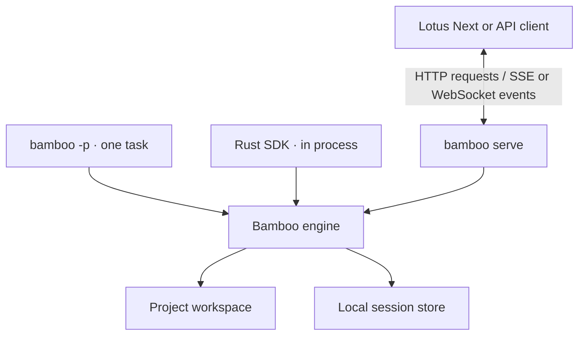
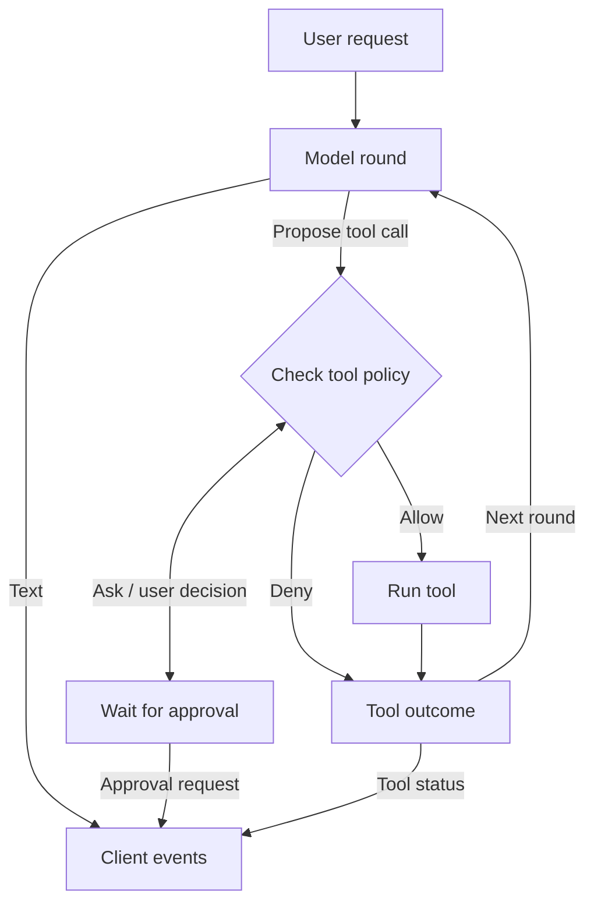
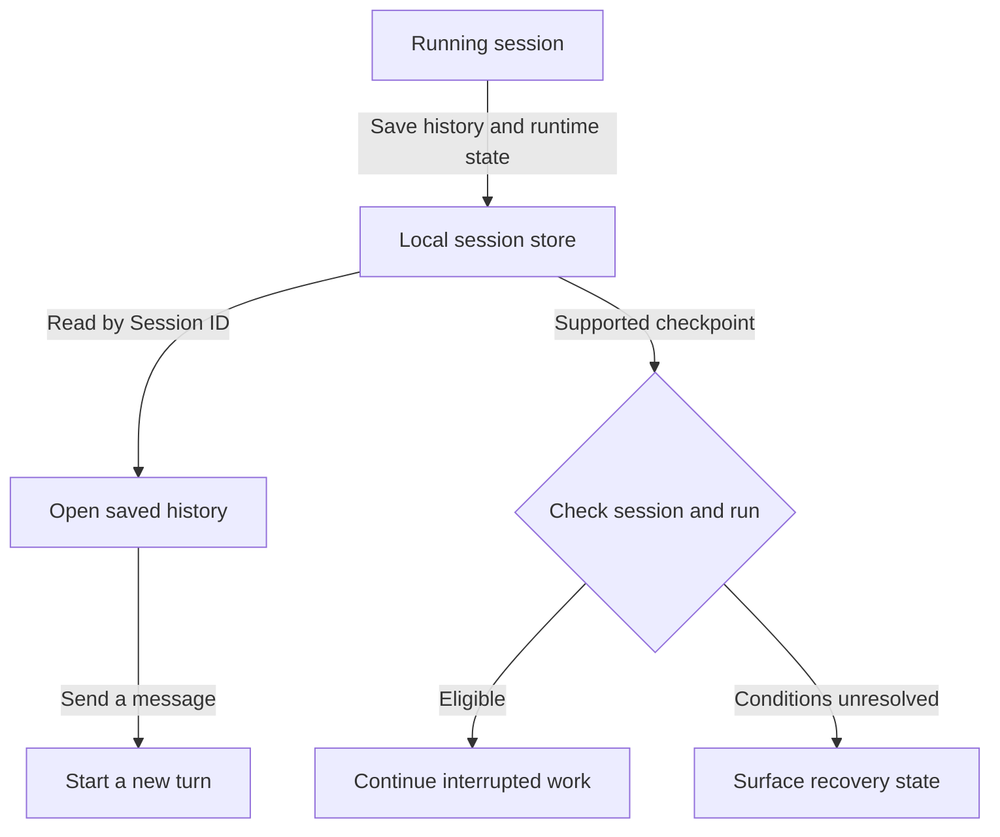
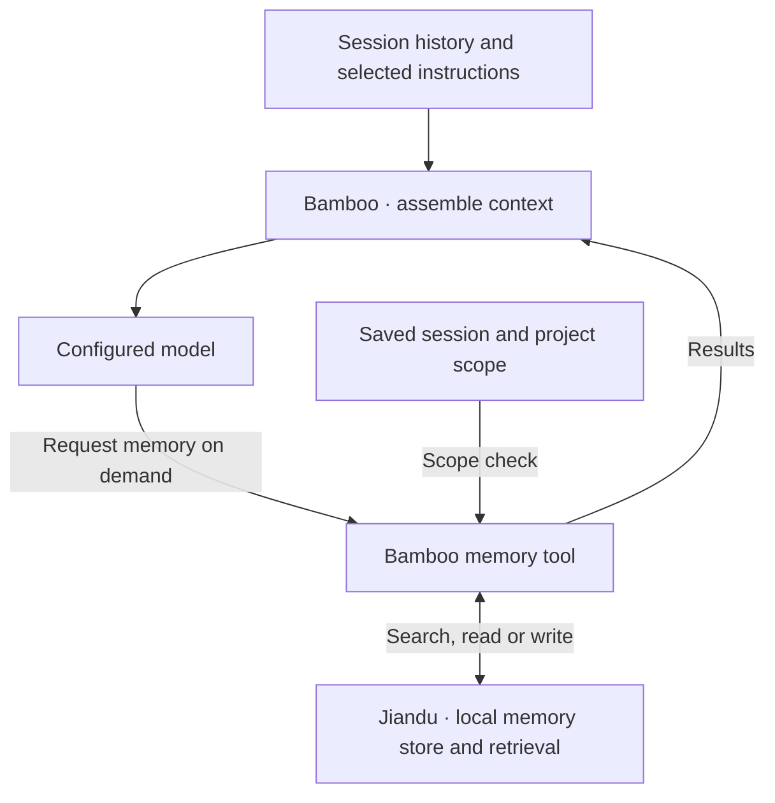
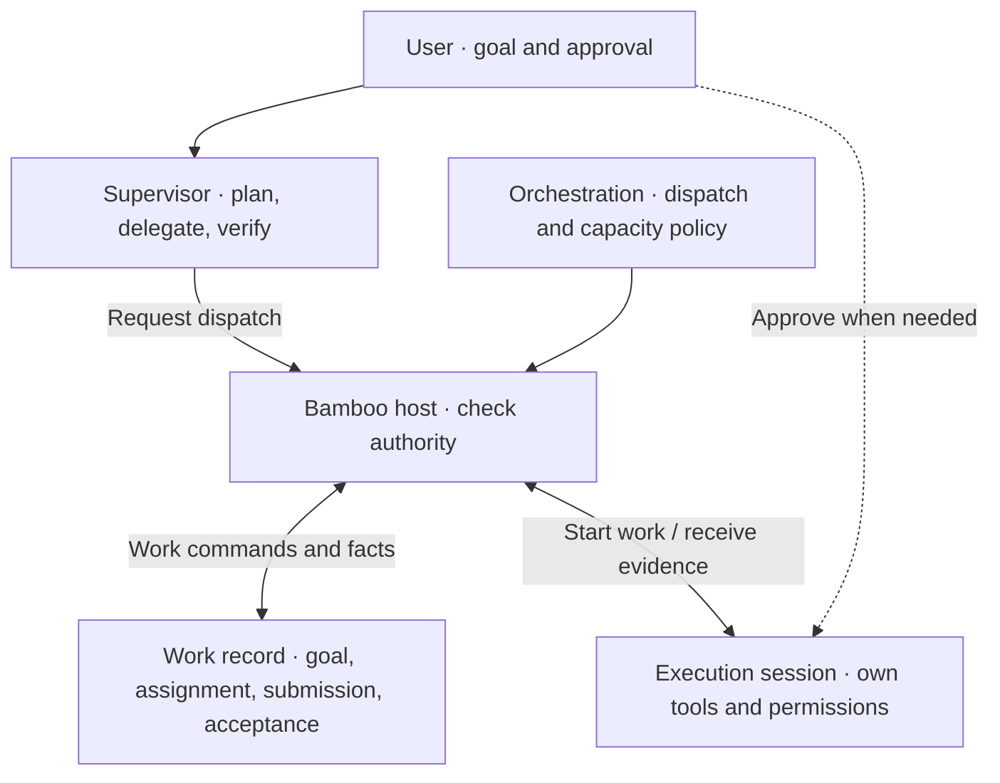
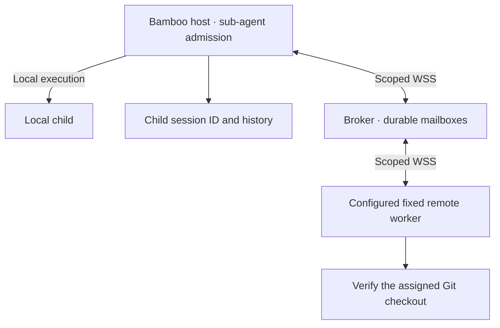

# Bamboo architecture

[简体中文](./architecture.zh-CN.md) · [Bamboo README](../README.md)

A single run can end while its session and Work are still open. Bamboo keeps session history, run state, and Work records separately. You can open a conversation again or reassign Work while keeping its goal and acceptance criteria.

## Runtime entry points

All three entry points use the same engine code. The SDK embeds the engine in your process. Web clients connect to a running server. [CLI, HTTP and SDK examples](./guides/GETTING_STARTED.md) · [Rust crate boundaries](./architecture-crates.md)

## Tool calls and approvals

A denied call also produces an outcome for the next model round, so the agent can report the block or choose an allowed action. [Permissions](./config-reference.md#permissions) · [User responses](./guides/API.md#submit-user-response) · [Event types](./guides/API.md#agentevent-types)

## Sessions and recovery

Reopening a session reads its history. Recovery of an interrupted run uses a supported checkpoint and fresh identity and ownership checks. [Session and run identity](./session-inbox-router.md#components-and-ownership) · [Storage](./session-storage-v3.md#current-boundary) · [Goal recovery](./goal-recovery.md#completion-and-restart)

## Project context and memory

Memory queries use the saved Session, Section and Project context. Switching folders preserves that scope. Bamboo puts returned memory into the model context as a tool result. [Memory ownership and scope](../crates/infra/bamboo-skills/assets/bamboo-manual/references/memory.md#ownership-and-scope) · [Project identity](./project-identity.md#project-and-workspace) · [Jiandu](https://github.com/bigduu/Jiandu)

## Supervisor, Work and execution

Work records outlive individual execution attempts, so a new assignment can use the same goal and acceptance criteria. The user can approve a tool while work runs and accept the delivered work separately. [Supervisor role](./supervisor-identity.md#model-role-and-thinking-mode) · [Work controls](./guides/TICKET_CONTROLS.md) · [Work records](../crates/infra/bamboo-tickets/src/lib.rs) · [Orchestration](../crates/engine/bamboo-orchestration/src/lib.rs)

## Sub-agent placement

The host owns Child identity and history. In the fixed remote setup, the broker routes messages and the worker checks its checkout before execution. [Remote topology and setup](./design/architecture-overview.md) · [Fixed remote acceptance](../tests/remote_broker_activation.rs) · [Server deployment](./guides/DEPLOY.md)
