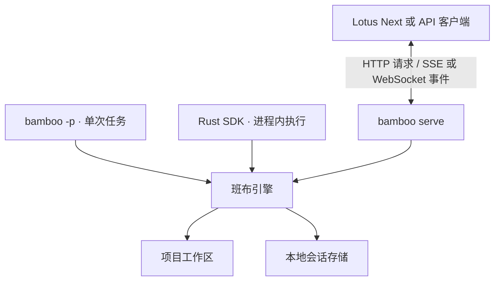
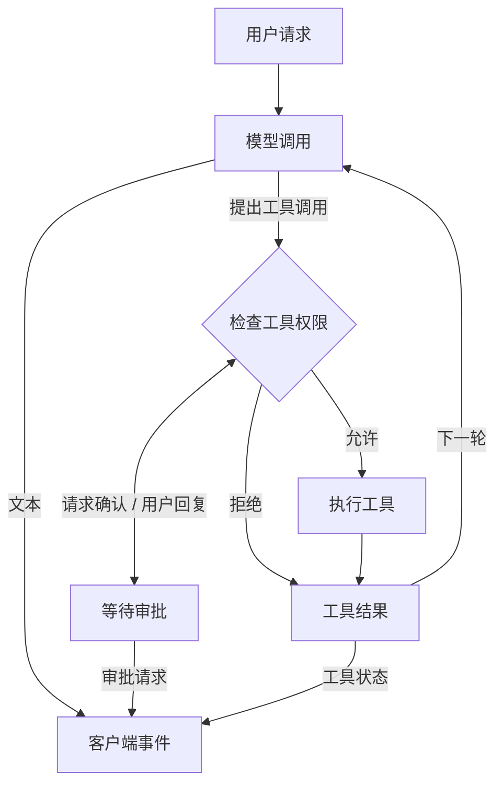
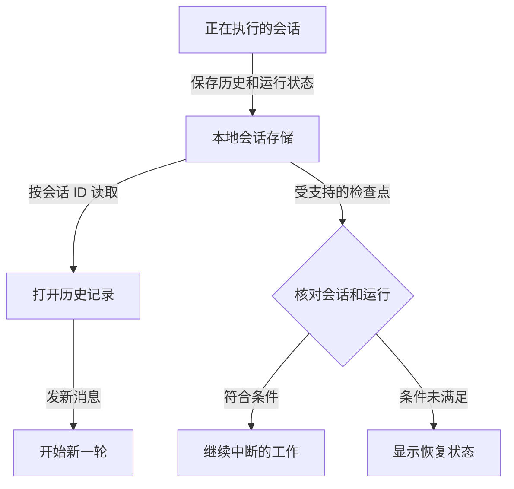
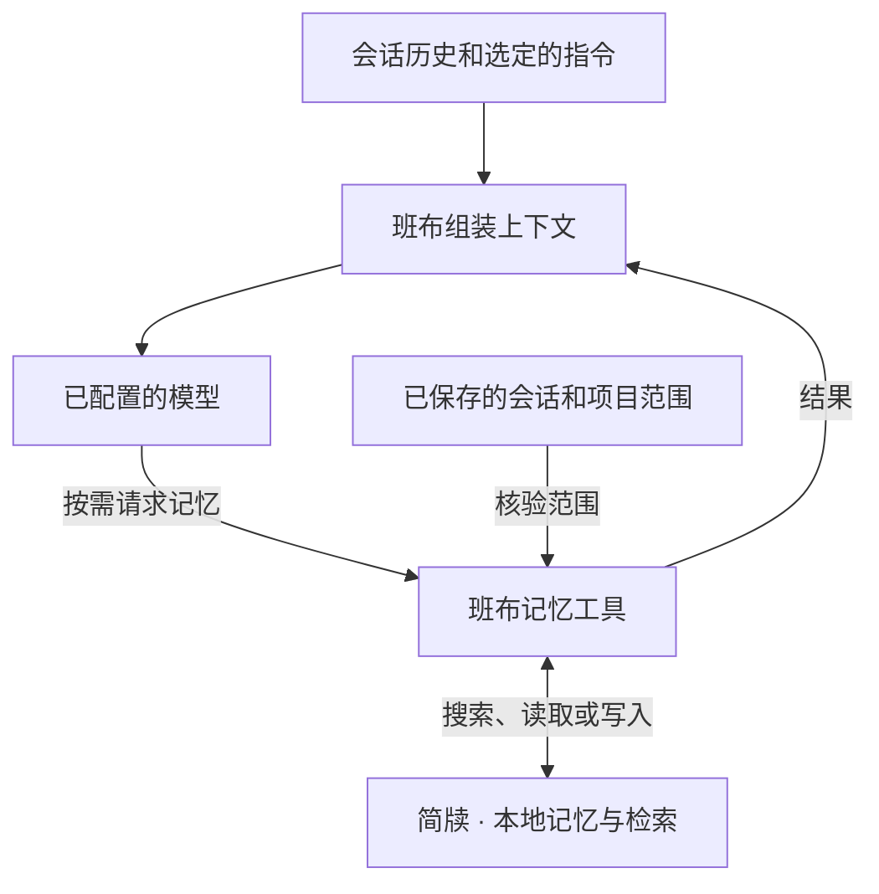
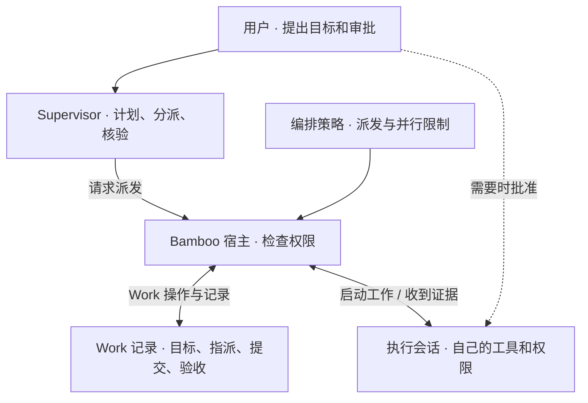
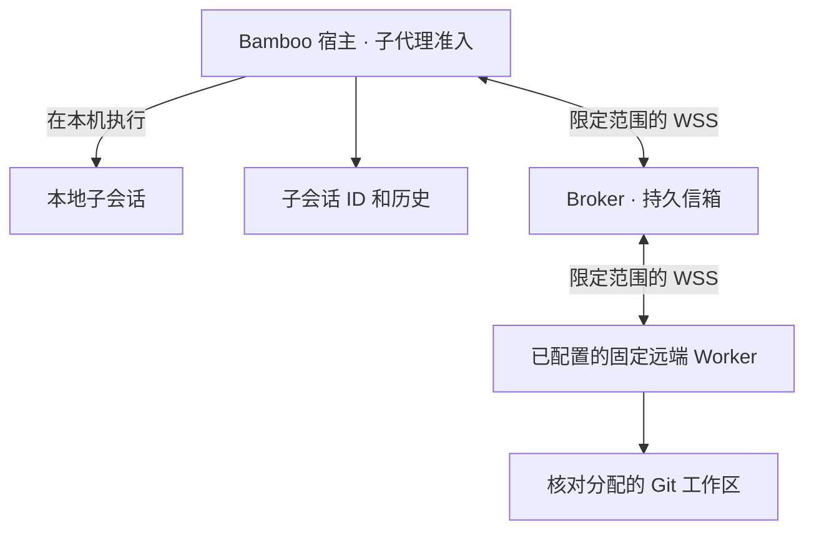

# 班布架构

[English](./architecture.md) · [班布 README](../README.zh-CN.md)

一次运行结束后，会话和 Work 还可以继续。班布分别保存会话历史、运行状态和 Work 记录。你可以回到原会话，也可以重新指派 Work，沿用已有的目标和验收条件。

## 运行入口

三个入口使用同一套引擎代码。Rust 应用可以把引擎嵌进自己的进程，网页和 HTTP 客户端则连接正在运行的服务。[CLI、HTTP 和 SDK 示例](./guides/GETTING_STARTED.md) · [Rust Crate 分层](./architecture-crates.md)

## 工具调用与审批

工具调用被拒绝时，班布也会把结果交给下一轮模型。模型可以说明哪里被拦住，或选择权限允许的操作。[权限配置](./config-reference.md#permissions) · [提交用户回复](./guides/API.md#submit-user-response) · [事件类型](./guides/API.md#agentevent-types)

## 会话保存与恢复

重新打开会话通常是读取历史。恢复中断的任务需要受支持的检查点，并校验会话身份和运行归属。[会话与运行标识](./session-inbox-router.md#components-and-ownership) · [会话存储](./session-storage-v3.md#current-boundary) · [Goal 恢复](./goal-recovery.md#completion-and-restart)

## 项目上下文与简牍记忆

记忆查询使用会话已保存的项目和分组归属。切换工作目录时仍沿用这个范围，查到的内容作为工具结果交给模型。[记忆归属与范围](../crates/infra/bamboo-skills/assets/bamboo-manual/references/memory.md#ownership-and-scope) · [项目标识](./project-identity.md#project-and-workspace) · [简牍](https://github.com/bigduu/Jiandu)

## Supervisor、Work 与执行

同一个 Work 可以重新指派，执行会话换了，任务目标和验收条件仍在。用户可以在执行时审批工具，交付后再决定是否验收。[Supervisor 职责](./supervisor-identity.md#model-role-and-thinking-mode) · [Work 操作](./guides/TICKET_CONTROLS.md) · [Work 记录](../crates/infra/bamboo-tickets/src/lib.rs) · [编排策略](../crates/engine/bamboo-orchestration/src/lib.rs)

## 子代理的运行位置

宿主管理子会话的身份和历史。使用固定远端 Worker 时，Broker 投递消息，Worker 在执行前核对工作区。[远端部署架构](./design/architecture-overview.md) · [固定远端验收](../tests/remote_broker_activation.rs) · [部署服务](./guides/DEPLOY.md)
