# Supervisor Session Directory:权威的并行 session 管理视图

> 状态:设计稿(#2413)。关联讨论:Supervisor delegation-first 政策把所有执行推向
> bounded SubAgent;对于"用户同时推进 5 件事"的长半径并行工作流,独立 Ordinary Root
> 才是正确形状,但 Supervisor 目前只能靠自己的"记忆"(工具回执)管理它们。
> 本设计补一个**权威的、只读的 session 目录**,让 Supervisor 不靠记忆做编排。

## 1. 问题

Supervisor 通过 `session_control create/followup/loop` 驱动独立 Root 时,存在三个盲区:

| 盲区 | 现状 | 后果 |
|---|---|---|
| 我开了哪些 session | 只能回放自己的创建/回执记忆 | 上下文压缩后丢失;重启后不可恢复 |
| 用户开了哪些 session | 完全不可见(`SupervisorSessionDiscovery` 明确 "never scan the global Session index") | 无法把用户自开的工作流纳入协调 |
| 用户是否接管过 | 无任何信号 | 对已被人类接管的 session 继续 followup 是噪音;对没接管的又不跟进是弃管 |
| 各 session 进度 | 仅 linked session 可 deep inspect,且要全量加载 session | 无轻量分页的进度面 |

## 2. 权威模型(全部复用既有地基,不新增权威源)

```mermaid
graph LR
    SC["session_control<br/>action=directory"] --> PORT["SupervisorDirectoryPort<br/>(bamboo-server 安装)"]
    PORT --> AUTH["caller 权威校验<br/>复用 SupervisorSessionDiscovery::caller"]
    PORT --> LINKS["SupervisorManagementState.links<br/>origin = supervisor_created"]
    PORT --> IDX["SessionIndexEntry<br/>project_id ∈ allowed_projects<br/>origin = user_opened"]
    IDX --> ENG["last_human_input 镜像<br/>(接管信号)"]

    style SC fill:#1e3a5f
    style PORT fill:#2d4a2d
```



关键原则:

1. **观察不是控制**。directory 返回的任何 entry 都不授予 followup/loop/attach 权
   限;控制仍走既有 link + CAS 契约。与 `SubAgents.tsx` 的
   "expansion is presentation state, never execution authority" 同构。
2. **supervisor-created 以 links 为准**。创建即插 `SupervisorManagedLink`
   (`supervisor_management.rs:608`),links 是唯一权威,creation 回执只是记忆。
3. **user-opened 以全局索引为准,但只暴露 Host 授权 Project 内的顶层 Root**:
   `project_id ∈ state.allowed_projects`、`parent_session_id == None`、
   非 caller 自身、非已存在于 links 的条目。children 永不进目录(那是各 parent
   自己的 SubAgent 树,不是并行工作流单元)。
4. **进度取索引镜像,不做 deep inspect**。单条 entry 只读 `SessionIndexEntry`
   镜像字段(title/last_run_status/last_activity_at/has_pending_question/
   last_human_input),不加载 session.json。深度检查仍走既有
   `session_history` list/inspect(仅 linked)。

## 3. 工具契约

`session_control(action=directory)`,READONLY_PARALLEL(与 `scope` 同级),
仅当 Host 安装了 `SupervisorDirectoryPort` 时出现在 action enum 中。

请求:

```json
{ "action": "directory",
  "query":  "可选,128B 上限,对 session_id/project_id/title 前缀匹配",
  "limit":  "可选 1..=20,默认 20",
  "cursor": "可选,复用 DirectoryCursor v1 形态(binding+query+limit+after)" }
```

响应 entry:

```json
{
  "session_id": "…",
  "origin": "supervisor_created" | "user_opened",
  "linked": true,                // 是否处于 live management link(followup/loop 可用)
  "project_id": "…",
  "title": "…",                  // 截断 256 chars
  "created_at": "…", "last_activity_at": "…",
  "last_run_status": "running|completed|error|…|unknown",
  "has_pending_question": false,
  "engagement": {                // null ⇒ 创建以来无人类 UI 输入
    "last_human_input_at": "…",
    "source": "user"             // user = UI 路由;host 派发不记(见 §4)
  }
}
```

**接管(takeover)的定义**:对 `origin=supervisor_created` 的 entry,
`engagement.last_human_input_at > (该 link 的)target_created_at` 即"人类已介入"。
对 `origin=user_opened`,存在即人类在驾驶。directory 不做这个减法判断,把两个
时间戳都给模型,由 Supervisor 结合自己的 dispatch 时间解释——观察事实与解释分离。

错误语义:cursor 绑定失效→`session_discovery_cursor_stale` 同款(重新起页);
caller 权威失效→`session_discovery_authority_required`;无目录授权(未安装
port)→ 明确的 recoverable blocker,不得静默降级。

## 4. 人类接管信号(engagement)

- **打点位置**:聊天 ingress(`handlers/agent/chat`)是 canonical Human UI 路由。
  在 Human 输入被持久化进 session 的 checkpoint 处,向
  `AgentRuntimeState.last_human_input: Option<HumanInputMark>` 写入
  `{at: Utc::now(), source: "user"}`;`SessionStoreV2` 保存路径把它镜像进
  `SessionIndexEntry.last_human_input`(与 `has_pending_question`/`plan_mode`
  的镜像模式完全一致)。
- **host 派发不记 human engagement**:`session_control create` 的 first
  instruction、`session_message` followup 走 Host/工具路由,不打点。这保证
  "engagement 存在" 严格等价于"人类在 UI 上介入过",Supervisor 自己的 dispatch
  不会污染信号。
- 信号是**陈述性的**:directory 只报告事实(最后一次人类 UI 输入),不断言
  "用户已接管且 Supervisor 应当退出"——策略留给模型与用户约定。

## 5. 委派政策更新(工作形状路由)

`SUPERVISOR_DELEGATION_GUIDANCE` 增补(保持有界,替换现有 create 句的一部分):

> 短半径、单次可验证的任务 → bounded SubAgent;长生命周期、人类可见可接管的
> 并行工作流 → 独立 Ordinary Root,并用 session_control directory 观察它们的
> origin/engagement/进度:已被人接管(entry 有 engagement)的不要继续 followup
> 打扰,除非用户要求;unlinked 的 user_opened 工作流可以纳入协调但同样不授予
> 控制。directory 观察永远不是完成证据。

Standard 与 Ultra 两种身份都渲染(既有 `build_root_orchestration_context_block`
路径已保证),`supervisor_delegation_first` 引擎测试扩展断言新句子。

## 6. 分阶段验收

**Phase 1(本 issue,端到端切片)**

1. `AgentRuntimeState.last_human_input` + 索引镜像 + 存储测试。
2. 聊天 UI ingress 打点(source="user")。
3. `SupervisorDirectoryPort`(bamboo-server):caller 权威 + links ∪ 授权索引
   合并、分页、query;`session_control` directory action + schema。
4. 引导词增补 + 引擎测试。
5. `cargo test --locked`、`fmt --check`、`clippy` 全绿。

**Phase 2(独立 issue,非本切片)**:Lotus/Bodhi 的人类侧看板(同一目录数据的
UI 呈现)、接管后的显式让渡协议(用户可选择"此 session 归我,Supervisor 停手")、
按 engagement 的自动化巡检节奏。

## 7. 非目标

- 不改 SubAgent/actor 语义与嵌套政策。
- 不新增任何写/控制权力;directory 是纯观察面。
- 不跨 Project;只显示 `allowed_projects` 内的 session。
- 不暴露 peer transcript;单条 entry 不含消息内容。

## 8. 安全考量

- 目录条目不含 transcript/凭证;深度检查仍受既有授权约束。
- 未安装 port 时 directory 动作不存在于 enum——能力由 Host 安装决定,模型不能
  自选。
- 索引扫描被 `allowed_projects` 硬过滤;links 容量上限(256)照旧生效。
