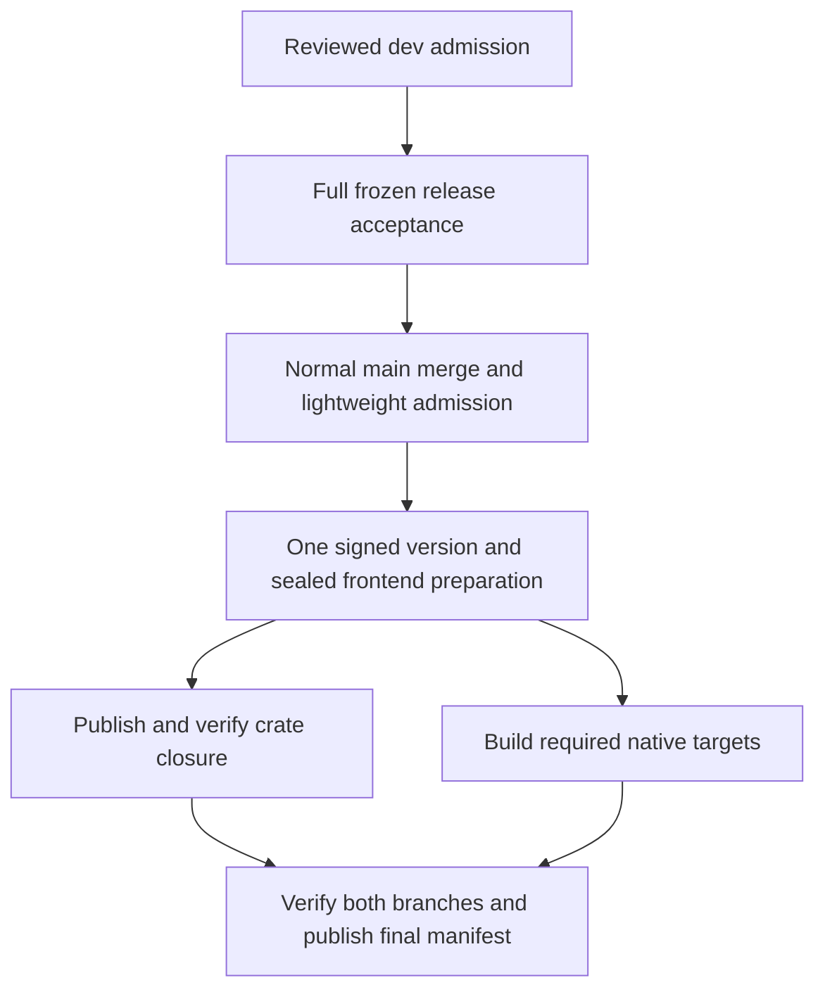

# CI and publication flow

This is the operating guide for Bamboo's CI and automatic release path. The
[Release Process](../../CONTRIBUTING.md#release-process) remains authoritative
for cuts, original-source repairs, protected admission and credentials.
[Parallel Development](../../gitflow.md) defines ownership and local evidence.

## Phase contracts

| Phase | Trigger and owner | Required result |
| --- | --- | --- |
| Development admission | A bounded PR to `dev`; its owner | Required `Test` compiles the locked workspace; affected local tests, regression coverage and current review pass. |
| Frozen release acceptance | Same-repository `release/<cut-SHA>` PR to `main`; one release owner | Full tests, all-feature checks, lint, security and Linux/macOS/Windows acceptance pass on the actual PR merge source. The frontend workflow separately validates the original release head. |
| Main admission | Normal release merge pushes `main`; CI | Authenticate the completed release acceptance against the actual ordered merge parents, reviewed release tree, source ancestry and original job attempts. |
| Publication preparation | Successful main-push CI; the canonical publisher | Independently authenticate source/evidence, reserve one version and transport its exact sealed frontend bytes. |
| Crate publication | Isolated Cargo publisher, concurrent with native builds | Resume the same reservation, stamp disposable manifests, publish in dependency order, then verify registry checksums, source and embedded frontend. |
| Native builds | Source-selected native runners, concurrent with crate publication | Verify prepared frontend transport and build the actual versioned main source without publication credentials. |
| Final assets | The existing final publisher, after both branches succeed | Authenticate completed crates and all required native receipts, then verify immutable uploads. The final manifest signals complete binary availability. |

The full Rust suite belongs to frozen release acceptance. Main admission is a
real verification gate that reuses that result; it is not a claim that tests ran
again on main. A missing or failed proof stops publication. A successful dev
compile does not establish release acceptance.

Keep required check names stable. Do not use empty success jobs, synthesized
statuses, `[skip ci]`, or workflow-level path filters to bypass required gates.
The current repository's verified capabilities, rather than an assumed merge
queue or auto-merge setting, determine its admission route.

## Freeze once and preserve source identities

1. Finish the bounded changes through protected `dev` admission. Freshly read
   actual dev HEAD, then record its UTC time, full SHA, tree and finite scope.
2. Create `release/<that-40-character-SHA>` normally at that exact commit. Keep
   dev open while the release owner validates this frozen candidate.
3. Complete current-head/base review, the full promotion suite and the separate
   original frontend-head contract. Record run URLs, actual tested source/tree,
   toolchain, lockfile, features, profile and results.
4. Use the normal two-parent release merge. Main admission authenticates that
   exact merge and its completed pre-merge evidence. Do not update the release
   with unrelated dev changes merely because dev advanced.
5. For a necessary repair, follow the separate original fix `F` and protected-dev
   integration `U` procedure in the Release Process. Neither one's evidence
   substitutes for the other. Preserve the cut and original failure evidence.

The release head, PR synthetic merge, final main merge and workflow controller
are separate Git identities. Equal trees alone do not make their binaries or
runtime metadata interchangeable. In particular, version stamping and
commit-derived generated metadata remain bound to the actual formal build.
This process reuses acceptance evidence; it does not publish an unversioned CI
binary or a binary produced from another commit.

## Authenticate acceptance before publication

The controller for `workflow_run` comes from protected default `dev`; the
product source comes from the successful main-push CI event. Never assume the
controller SHA is the product SHA. Establish authority before checking out or
executing product code and before exposing publication credentials.

Main admission and the automatic publisher must independently verify:

- The same repository's normal merged release PR, exact base/head, ordered
  two-parent main merge, unchanged reviewed release tree and cut ancestry.
- The release head's normal admission into protected dev and current main
  freshness. A direct main push or stale queued source cannot publish.
- The actual latest applicable full release CI result, all required platform
  jobs and `Promotion Source`, with completion strictly before the merge.
  Never search past a newer failed exact-input run to find an older green one.
- Original job/run attempts when successful jobs are retained by a failed-only
  rerun. A partial rerun does not make earlier jobs execute again.
- Historical empty-PR-association evidence only through the reviewed producer,
  official check suite, executed workflow and checkout-free source-job proof.
  A conflicting association, arbitrary log or self-described receipt cannot
  grant publication authority.

API errors and unknown, missing, ambiguous or changed evidence fail closed.
Historical full main CI keeps its original evidence contract. A skipped heavy
job on the new main route cannot be accepted as an executed full test.

## One version and one publisher

Keep source manifests at `0.0.0`. The existing allocator reserves an unused
`YYYY.M.N` version for one accepted source and frontend identity. Stamp only
disposable publication/build checkouts and preserve external dependency locks.
The locked frontend package, version, archive and manifest hashes remain fixed;
registry fetch failures must not select a moving `latest` or another bundle.

All production attempts share `bamboo-crate-publication`, with queued entries
retained and cancellation disabled. Parallel platform jobs are build workers,
not independent publishers or version allocators. Native workers receive no
GitHub publication token, Cargo registry token or signing key.

The current v2 executable contract requires macOS ARM, Linux x64 and Windows
x64. Historical v1 sources retain their four-platform contract, including macOS
Intel. The accepted source selects the contract; a dispatch or retry cannot
remove a target. See [Shared Bamboo executables](shared-executable-assets.md).

### Parallel execution and cache boundaries

`automatic` authenticates the main source, reserves the signed identity, and
uploads `bamboo-prepared-frontend-attempt-<preparation-attempt>`. The independent
`prepared_release` job output binds the original attempt, same run/controller,
Release ID, source/tree, version, frontend hashes and selected platform contract.
The transport itself grants no authority.

After preparation succeeds, `publish-crates` and `executables` both depend only
on `automatic` and run concurrently. The crate worker authenticates fresh signed
progress for that exact reservation without calling the allocator again. It
cannot replace sealed frontend assets once workers have started. Native workers
validate exactly two bounded regular frontend files, reject extras or symlinks,
and verify the independent hashes before building. They need no draft-Release
API access, signing key or publication token.

`publish-executables` joins `automatic`, `publish-crates` and `executables`.
It still authenticates the completed public crate receipt and all required
native outputs before publishing the final manifest. Failure in either branch
cannot advertise a complete binary release.

Native caches map `RUNNER_TEMP/bamboo-executable-target`. Cache compatibility
includes the source profile, producer contract and target, together with the
action's Rust toolchain, environment and Cargo input keys. Restore dependencies,
then evict workspace executables, fingerprints and generated build outputs so
the actual source/version regenerates its embedded frontend evidence. Preserve
the source's compiler/profile/wrapper restrictions. Historical v1 and frozen
restore-only sources do not write these caches.

Crate readiness and binary readiness are separate. A public crate Release is
insufficient for desktop consumption until every asset required by its source
contract and the final manifest have been uploaded and verified. Downstream
consumers pin the actual version, source and hashes after that point.

## Failure and recovery

- Preserve the original failed run, source and reservation. Retry the same
  identity; do not allocate a new version to hide a partial failure.
- Prefer failed-job reruns when supported, retaining successful native outputs
  and their actual attempt numbers. A full rerun must respect existing signed
  checkpoints and immutable asset identities.
- Select frontend transport using the successful preparation's original attempt,
  not the retrying job's current attempt. Native transport retention is bounded;
  missing expired inputs require the normal verified rebuild route.
- If the same main CI run is retried, fresh admission may advance only that
  run's attempt while preserving all source and pre-merge bindings. Keep original
  signed reservation/checkpoint attempts intact; never relabel them as new work.
- After an uncertain upload, read back the exact remote identity before retrying.
  Existing identical bytes may be reused; conflicting bytes stop publication.
- Complete only missing authorized assets. Never replace an uploaded asset,
  move a frozen tag, re-sign foreign evidence or substitute a locally rebuilt
  binary for the original accepted one.
- Cancel only runs owned by this workstream or explicitly handed to its owner.
  Do not borrow another release's runner window, output directory or cache writer.

## Activate and measure

Land workflow and verifier changes through a reviewed PR to protected dev,
including executable positive/negative policy and authority tests. Preserve
current full acceptance on the next normally scoped frozen release; do not
advance an active frozen branch just to activate tooling.

Before promotion, verify the actual current required checks and workflow
definitions. Review changes to pinned historical producers as authority changes.
After promotion, record the lightweight main run, canonical publisher run,
reserved source/version/frontend, platform receipts and final manifest identity.

Compare actual critical-path and step timings against a recorded baseline.
Cache restoration alone is not acceleration evidence, and synthetic policy tests
do not establish native builds or production publication. This document records
the workflow contract; each release still needs its own real acceptance evidence.

### Recorded baseline

For `v2026.10.15`, source
`d4e79947805957418b0ed18d4b05ac7bcbb1dc2d`, the October 21, 2026 run spent about
75 minutes in [post-merge main CI](https://github.com/bigduu/Bamboo-agent/actions/runs/39602293449).
The [publisher](https://github.com/bigduu/Bamboo-agent/actions/runs/39613148725)
then spent about 22 minutes on the crate stage, followed by native builds whose
slowest job took about 42 minutes, and about 2 minutes on final asset publication.
From the main merge to complete assets, elapsed time was about 2 hours 24 minutes,
excluding pre-merge acceptance.

That historical source required all four v1 targets; its longest native job was
macOS Intel. New v2 releases have three targets. Compare each source contract
separately and retain exact source/run/attempt/platform details when measuring
the new workflow. These timings explain the optimization; they do not claim a
measured speedup for an unpublished candidate.

Parallel execution changes the post-preparation critical path from approximately
`crate duration + slowest native duration` to their maximum, plus preparation,
runner waiting and finalization. Measure the real run; this is the scheduling
model, not a promised duration or percentage improvement.
